# 基于SpringBoot的游戏账号交易系统的设计与实现

> 🎓 **计算机毕业设计 · 基于SpringBoot的游戏账号交易系统的设计与实现**
>
> 本仓库只放**项目介绍 + 运行截图**（截图是站点带水印的原图，存在仓库 `images/` 里）。
>
> 👉 **完整可运行源码 / 数据库脚本 / 部署文档：[点我获取](https://geekcode.top/archives/%E5%9F%BA%E4%BA%8ESpringBoot%E7%9A%84%E6%B8%B8%E6%88%8F%E8%B4%A6%E5%8F%B7%E4%BA%A4%E6%98%93%E7%B3%BB%E7%BB%9F%E7%9A%84%E8%AE%BE%E8%AE%A1%E4%B8%8E%E5%AE%9E%E7%8E%B0?utm_source=github)**
>
> 💬 咨询微信：**ir9372**　|　🌐 更多项目：[极客代码 geekcode.top](https://geekcode.top/?utm_source=github)
>
> 📌 项目详情页：<https://geekcode.top/archives/%E5%9F%BA%E4%BA%8ESpringBoot%E7%9A%84%E6%B8%B8%E6%88%8F%E8%B4%A6%E5%8F%B7%E4%BA%A4%E6%98%93%E7%B3%BB%E7%BB%9F%E7%9A%84%E8%AE%BE%E8%AE%A1%E4%B8%8E%E5%AE%9E%E7%8E%B0?utm_source=github>

<table><td width="230" align="center"> <b>扫码加微信 ir9372</b></td><td valign="middle">📦 源码 = 项目介绍 + 全部运行截图 + 数据库 + 部署文档 👉 点上方任意截图，直接跳到 <b>极客代码 geekcode.top</b> 详情页</td></table>

---

<h1>基于SpringBoot的游戏账号交易系统的设计与实现</h1>
<h2>项目概述</h2>

本项目旨在构建一个基于 Spring Boot 框架的游戏账号交易系统，解决当前游戏虚拟物品交易中信息不对称、安全性低及交易流程繁琐等问题。系统采用前后端分离架构（Vue + Spring Boot），提供完整的账号展示、分类检索、秒杀抢购及订单管理功能。核心业务涵盖账号信息发布、商家入驻管理、用户在线交易及平台资讯服务。适用人群包括希望快速出售或购买游戏账号的个人玩家、专业游戏账号中介商以及平台运营管理人员。技术架构上，后端使用 Spring Boot 结合 MyBatis-Plus 实现高效数据持久化，引入 Apache Shiro 进行权限控制与安全认证；前端基于 Vue.js 开发，确保良好的交互体验。该项目实现了从账号上架、浏览筛选到下单支付的闭环交易流程，具备较高的实用价值与商业模拟意义。

<h2>技术架构</h2>
<h3>1. 整体架构设计</h3>

系统采用经典的分层架构模式，分为表现层、业务逻辑层、数据访问层和数据库层。前端通过 RESTful API 与后端通信，后端负责处理业务逻辑、权限校验及数据持久化。

<a href="https://geekcode.top/archives/%E5%9F%BA%E4%BA%8ESpringBoot%E7%9A%84%E6%B8%B8%E6%88%8F%E8%B4%A6%E5%8F%B7%E4%BA%A4%E6%98%93%E7%B3%BB%E7%BB%9F%E7%9A%84%E8%AE%BE%E8%AE%A1%E4%B8%8E%E5%AE%9E%E7%8E%B0?utm_source=github" title="查看完整源码">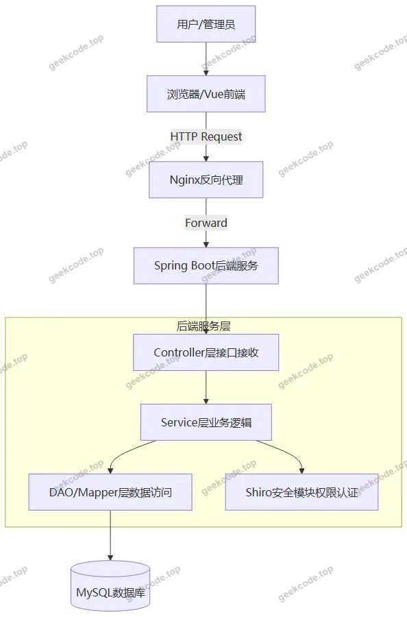</a>

<h3>2. 核心技术选型理由</h3>
<ul>
<li><strong>Spring Boot</strong>: 作为基础框架，利用其自动配置和起步依赖特性，简化了应用搭建过程，提高了开发效率，并内置 Tomcat 容器便于部署。</li>
<li><strong>MyBatis-Plus</strong>: 在 MyBatis 基础上增强，提供了通用的 CRUD 操作和条件构造器，大幅减少了 SQL 编写工作量，同时保留了灵活性以处理复杂查询。</li>
<li><strong>Apache Shiro</strong>: 轻量级且强大的 Java 安全框架，用于实现身份验证、授权、加密和会话管理。在本项目中主要用于区分普通用户、商家和管理员的角色权限，保障系统安全。</li>
<li><strong>Vue.js (集成式)</strong>: 虽然代码上下文主要体现后端，但项目类型为 <code>vue-integrated</code>，表明前端采用 Vue 生态构建单页面应用（SPA），提供流畅的用户体验。</li>
<li><strong>MySQL</strong>: 关系型数据库，用于存储账号信息、订单数据、用户信息及评论等结构化数据，保证数据的一致性和完整性。</li>
</ul>
<h3>3. 数据库设计要点</h3>

根据控制器和路由推断，数据库主要包含以下核心实体表：

<ul>
<li><strong>用户相关</strong>：<code>yonghu</code> (普通用户), <code>shangjia</code> (商家), <code>address</code> (收货地址)。</li>
<li><strong>商品相关</strong>：<code>shangpinxinxi</code> (账号信息/普通商品), <code>miaoshashangpin</code> (秒杀账号), <code>shangpinfenlei</code> (账号分类)。</li>
<li><strong>交易相关</strong>：<code>orders</code> (订单记录), <code>cart</code> (购物车)。</li>
<li><strong>内容相关</strong>：<code>news</code> (平台资讯), <code>aboutus</code> (关于我们), <code>discussmiaoshashangpin</code> (秒杀评论), <code>discussshangpinxinxi</code> (普通商品评论)。</li>
<li><strong>系统配置</strong>：<code>config</code> (系统参数配置)。</li>
</ul>
<h2>功能模块</h2>
<h3>前台用户端</h3>

前台界面面向普通消费者和商家，主要提供账号浏览、交易和互动功能。

<ol>
<li><strong>首页展示</strong></li>
</ol>
<ul>
<li>轮播图展示热门账号或平台公告。</li>
<li>推荐最新上架的账号信息和秒杀活动入口。</li>
</ul>
<ol start="2">
<li><strong>账号信息模块</strong></li>
</ol>
<ul>
<li><strong>账号列表</strong>：展示所有在售的游戏账号，支持分页浏览。</li>
<li><strong>账号详情</strong>：查看特定账号的详细属性（如等级、皮肤、段位等）、价格及卖家信息。</li>
<li><strong>账号分类</strong>：根据游戏类型或账号特征进行分类筛选。</li>
</ul>
<ol start="3">
<li><strong>秒杀账号模块</strong></li>
</ol>
<ul>
<li><strong>秒杀列表</strong>：展示限时特价的账号资源。</li>
<li><strong>秒杀评论</strong>：用户对已购买的秒杀账号进行评价交流。</li>
</ul>
<ol start="4">
<li><strong>平台资讯模块</strong></li>
</ol>
<ul>
<li><strong>公告列表</strong>：发布平台规则、维护通知等重要信息。</li>
<li><strong>新闻资讯</strong>：展示行业动态或游戏攻略文章。</li>
</ul>
<ol start="5">
<li><strong>个人中心模块</strong></li>
</ol>
<ul>
<li><strong>我的订单</strong>：查看历史交易记录，包括待支付、已完成等状态。</li>
<li><strong>我的收藏</strong>：管理收藏的感兴趣账号。</li>
<li><strong>个人信息</strong>：修改基本资料及绑定收货地址。</li>
</ul>
<h3>后台管理端</h3>

后台界面面向系统管理员，提供全面的数据管理和内容审核功能。

<ol>
<li><strong>系统登录</strong></li>
</ol>
<ul>
<li>管理员账户密码登录，集成 Shiro 认证机制。</li>
</ul>
<ol start="2">
<li><strong>账号信息管理 (<code>/shangpinxinxi</code>)</strong></li>
</ol>
<ul>
<li>对普通游戏账号进行增删改查操作。</li>
<li>审核商家提交的账号信息，确保合规性。</li>
</ul>
<ol start="3">
<li><strong>秒杀账号管理 (<code>/miaoshashangpin</code>)</strong></li>
</ol>
<ul>
<li>设置秒杀活动的开始时间、结束时间及库存数量。</li>
<li>管理秒杀账号的上架与下架状态。</li>
</ul>
<ol start="4">
<li><strong>订单管理 (<code>/orders/:status</code>)</strong></li>
</ol>
<ul>
<li>查看所有订单状态（未支付、已支付、发货、完成等）。</li>
<li>处理异常订单，进行退款或取消操作。</li>
</ul>
<ol start="5">
<li><strong>用户与商家管理</strong></li>
</ol>
<ul>
<li><strong>用户管理 (<code>/yonghu</code>)</strong>：查看注册用户信息，禁用违规账号。</li>
<li><strong>商家管理 (<code>/shangjia</code>)</strong>：审核商家入驻申请，管理商家资质。</li>
</ul>
<ol start="6">
<li><strong>内容管理</strong></li>
</ol>
<ul>
<li><strong>平台资讯 (<code>/news</code>)</strong>：发布和维护新闻公告。</li>
<li><strong>关于我们 (<code>/aboutus</code>)</strong>：编辑平台介绍页面内容。</li>
<li><strong>评论管理 (<code>/discussshangpinxinxi</code>, <code>/discussmiaoshashangpin</code>)</strong>：审核用户评论，删除不良言论。</li>
</ul>
<ol start="7">
<li><strong>分类管理 (<code>/shangpinfenlei</code>)</strong></li>
</ol>
<ul>
<li>定义和维护账号的分类标签体系。</li>
</ul>
<ol start="8">
<li><strong>系统配置 (<code>/config</code>)</strong></li>
</ol>
<ul>
<li>设置网站名称、Logo、联系方式等全局参数。</li>
</ul>
<h2>用户角色与权限</h2>

系统基于 Apache Shiro 实现细粒度的权限控制，主要划分为三种角色：

<table>
<thead>
<tr>
<th align="left">角色名称</th>
<th align="left">描述</th>
<th align="left">可访问功能模块</th>
<th align="left">权限说明</th>
</tr>
</thead>
<tbody><tr>
<td align="left"><strong>超级管理员</strong></td>
<td align="left">系统最高权限持有者</td>
<td align="left">全部后台模块</td>
<td align="left">- 拥有所有数据的增删改查权限。- 可管理系统配置、用户及商家账户。- 可审核所有内容（账号、评论、资讯）。- 可查看全量订单数据并进行干预。</td>
</tr>
<tr>
<td align="left"><strong>商家</strong></td>
<td align="left">账号提供方</td>
<td align="left">前台个人中心、部分后台功能（若存在独立入口）</td>
<td align="left">- <strong>注意</strong>：根据提供的路由列表，后台路由主要为管理员视角。通常商家在前台登录后，可通过“个人中心”或特定接口管理自己的商品。- 发布和管理自己名下的账号信息。- 查看属于该商家的订单。- 回复用户咨询或评论（视具体实现而定，当前截图仅显示评论管理为后台功能，推测商家可能无独立后台或权限受限）。</td>
</tr>
<tr>
<td align="left"><strong>普通用户</strong></td>
<td align="left">买家/访客</td>
<td align="left">前台所有公开页面</td>
<td align="left">- 浏览账号、资讯、公告。- 搜索和筛选账号。- 加入购物车、下单购买、参与秒杀。- 管理个人收藏、收货地址。- 发表账号评论。</td>
</tr>
</tbody></table>

<em>注：由于提供的后台路由中未明确区分商家专属后台路径（如 <code>/merchant/*</code>），且控制器中包含 <code>ShangjiaController</code> 位于后台路由下，推测商家可能主要通过前台个人中心进行简单管理，或者在后台列表中由管理员代为操作。本权限描述基于现有可见的路由结构推导。</em>

<h2>项目特色与创新点</h2>
<ol>
<li>
<strong>双模式交易机制</strong>
   项目不仅支持常规的账号买卖（<code>shangpinxinxi</code>），还专门设计了“秒杀账号”模块（<code>miaoshashangpin</code>）。这种双轨制能够满足不同用户需求：常规交易适合长期稳定的账号流通，而秒杀模式则能激发用户活跃度，提升平台流量和转化率。

</li>
<li>
<strong>完善的评价反馈体系</strong>
   针对不同类型的商品（普通账号 vs 秒杀账号），分别建立了独立的评论表（<code>discussshangpinxinxi</code> 和 <code>discussmiaoshashangpin</code>）。这使得用户可以针对特定场景的交易体验进行反馈，有助于形成更真实可信的交易信用环境。

</li>
<li>
<strong>安全的权限管控架构</strong>
   引入 Apache Shiro 而非简单的 Session 判断，实现了基于角色的访问控制（RBAC）。这不仅保护了后台管理接口不被非法调用，也为未来扩展更复杂的权限模型（如数据权限隔离）奠定了坚实基础。

</li>
<li>
<strong>高度集成的前后端协作</strong>
   采用 <code>vue-integrated</code> 模式，意味着前端构建产物直接嵌入后端资源目录或通过统一网关部署。这种架构简化了跨域问题处理，降低了运维复杂度，特别适合中小型毕业设计或初期创业项目快速上线。

</li>
<li>
<strong>灵活的分类与检索能力</strong>
   通过 <code>shangpinfenlei</code>（账号分类）模块，系统支持多维度的账号归类。结合 MyBatis-Plus 的动态 SQL 能力，可以实现高效的组合条件查询，帮助用户在海量账号中快速定位目标商品。

</li>
</ol>
<h2>部署环境</h2>

为确保系统正常运行，需准备以下软硬件环境：

<h3>1. 软件环境要求</h3>
<ul>
<li><strong>操作系统</strong>：Windows 10/11, Linux (CentOS 7+, Ubuntu 18.04+), macOS</li>
<li><strong>Java JDK</strong>：JDK 1.8 或更高版本（建议 JDK 8，兼容性好）</li>
<li><strong>Maven</strong>：3.6+ （用于依赖管理和项目构建）</li>
<li><strong>Node.js</strong>：v14.x 或 v16.x LTS （用于前端 Vue 项目的编译打包）</li>
<li><strong>npm/yarn</strong>：包管理工具</li>
<li><strong>数据库</strong>：MySQL 5.7 或 MySQL 8.0</li>
<li><strong>Web服务器</strong>：内置 Tomcat (Spring Boot 自带) 或外部 Nginx (用于生产环境反向代理)</li>
</ul>
<h3>2. 硬件环境建议</h3>
<ul>
<li><strong>CPU</strong>：Intel i5 / AMD Ryzen 5 及以上</li>
<li><strong>内存</strong>：8GB RAM 及以上（开发调试建议 16GB）</li>
<li><strong>硬盘</strong>：至少 20GB 可用空间</li>
</ul>
<h3>3. 启动步骤简述</h3>
<ol>
<li><strong>数据库初始化</strong>：创建 MySQL 数据库，导入项目提供的 <code>.sql</code> 脚本文件，建立表结构及初始数据。</li>
<li><strong>配置后端</strong>：修改 <code>application.yml</code> 中的数据库连接 URL、用户名和密码。</li>
<li><strong>编译前端</strong>：进入前端目录，执行 <code>npm install</code> 安装依赖，然后执行 <code>npm run build</code> 生成静态资源。</li>
<li><strong>集成部署</strong>：将生成的前端静态文件放入后端指定的资源目录（如 <code>src/main/resources/static</code> 或 <code>templates</code>），或在 Nginx 中配置指向后端 API 的反向代理。</li>
<li><strong>运行后端</strong>：使用 IDE 运行主启动类，或通过 Maven 命令 <code>mvn spring-boot:run</code> 启动服务。</li>
<li><strong>访问系统</strong>：浏览器访问 <code>http://localhost:8080</code> (默认端口)，即可看到前台首页或后台登录页。</li>
</ol>
<h2>五、技术特性</h2>
<ul>
<li>前后端集成部署，前端资源打包至后端 static 目录</li>
<li>使用 MyBatis-Plus 简化数据访问层开发</li>
<li>集成 Shiro 权限框架实现角色权限控制</li>
</ul>
<h2>六、功能模块截图</h2>
<h3>前台用户端</h3>
<h4>前台-秒杀账号列表</h4>

<a href="https://geekcode.top/archives/%E5%9F%BA%E4%BA%8ESpringBoot%E7%9A%84%E6%B8%B8%E6%88%8F%E8%B4%A6%E5%8F%B7%E4%BA%A4%E6%98%93%E7%B3%BB%E7%BB%9F%E7%9A%84%E8%AE%BE%E8%AE%A1%E4%B8%8E%E5%AE%9E%E7%8E%B0?utm_source=github" title="查看完整源码">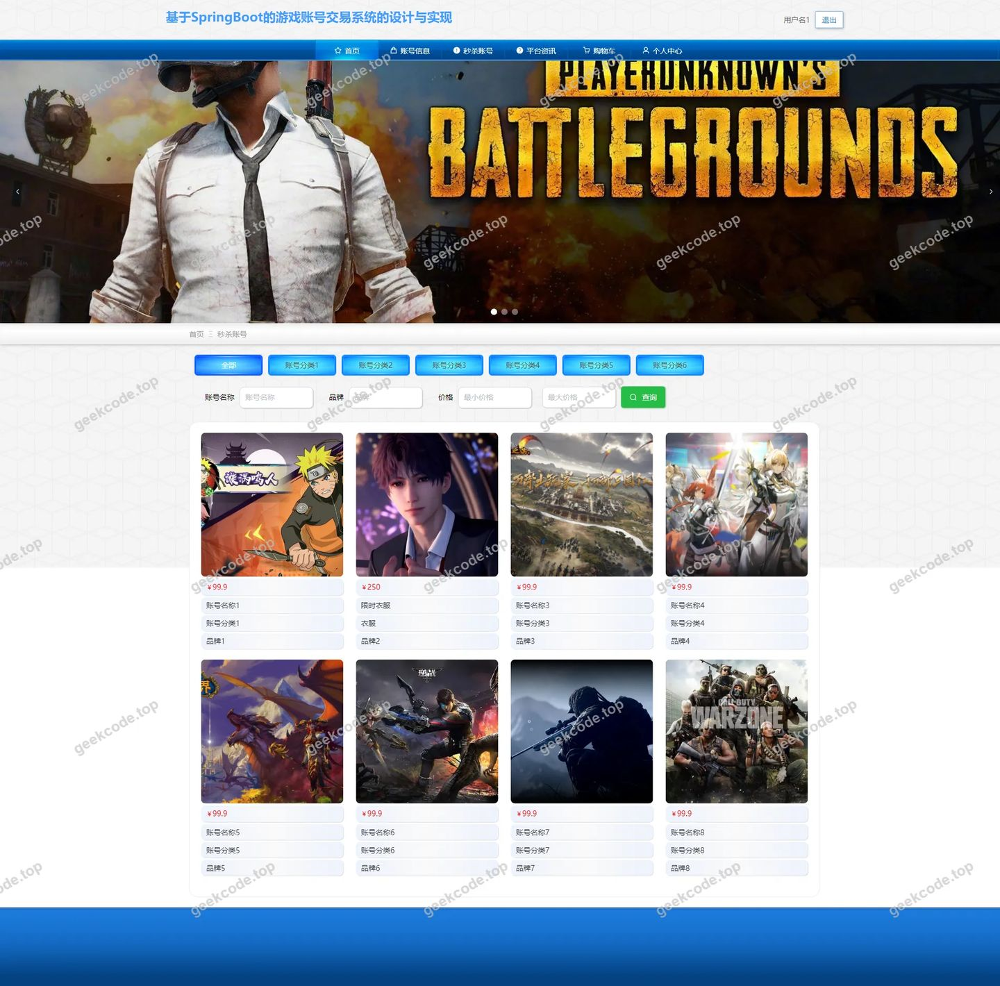</a>

<h4>前台-商家列表</h4>

<h4>前台-账号分类列表</h4>

<h4>前台-账号信息列表</h4>

<h4>前台-收藏列表</h4>

<h4>前台-个人中心</h4>

<a href="https://geekcode.top/archives/%E5%9F%BA%E4%BA%8ESpringBoot%E7%9A%84%E6%B8%B8%E6%88%8F%E8%B4%A6%E5%8F%B7%E4%BA%A4%E6%98%93%E7%B3%BB%E7%BB%9F%E7%9A%84%E8%AE%BE%E8%AE%A1%E4%B8%8E%E5%AE%9E%E7%8E%B0?utm_source=github" title="查看完整源码">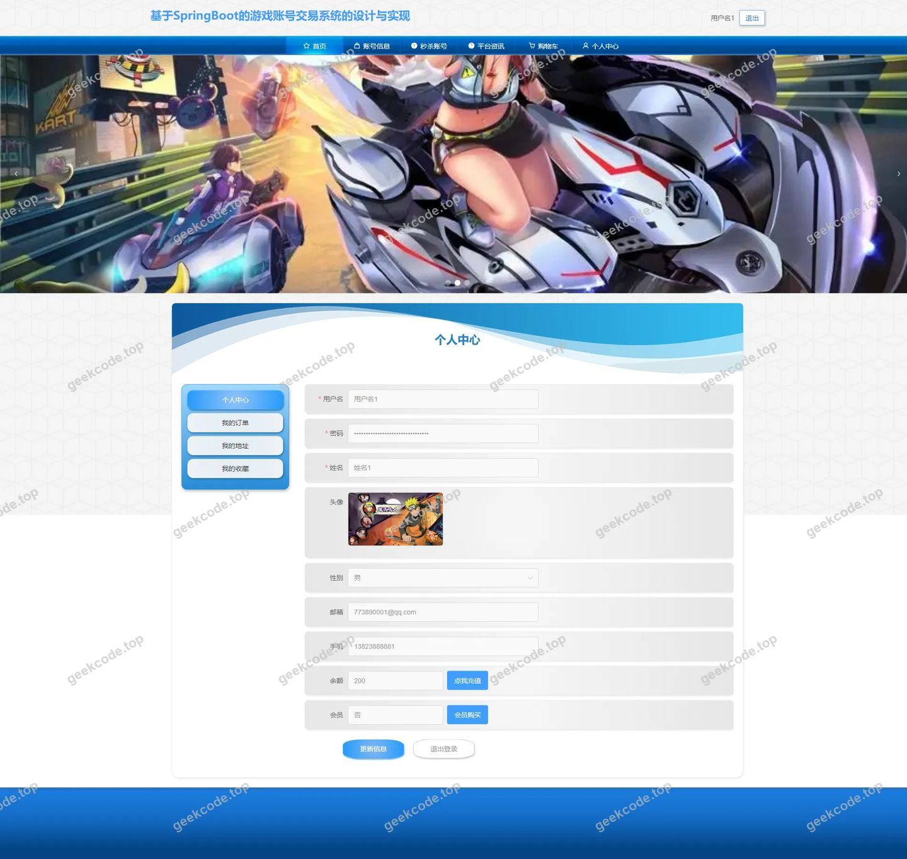</a>

<h4>前台-公告列表</h4>

<a href="https://geekcode.top/archives/%E5%9F%BA%E4%BA%8ESpringBoot%E7%9A%84%E6%B8%B8%E6%88%8F%E8%B4%A6%E5%8F%B7%E4%BA%A4%E6%98%93%E7%B3%BB%E7%BB%9F%E7%9A%84%E8%AE%BE%E8%AE%A1%E4%B8%8E%E5%AE%9E%E7%8E%B0?utm_source=github" title="查看完整源码">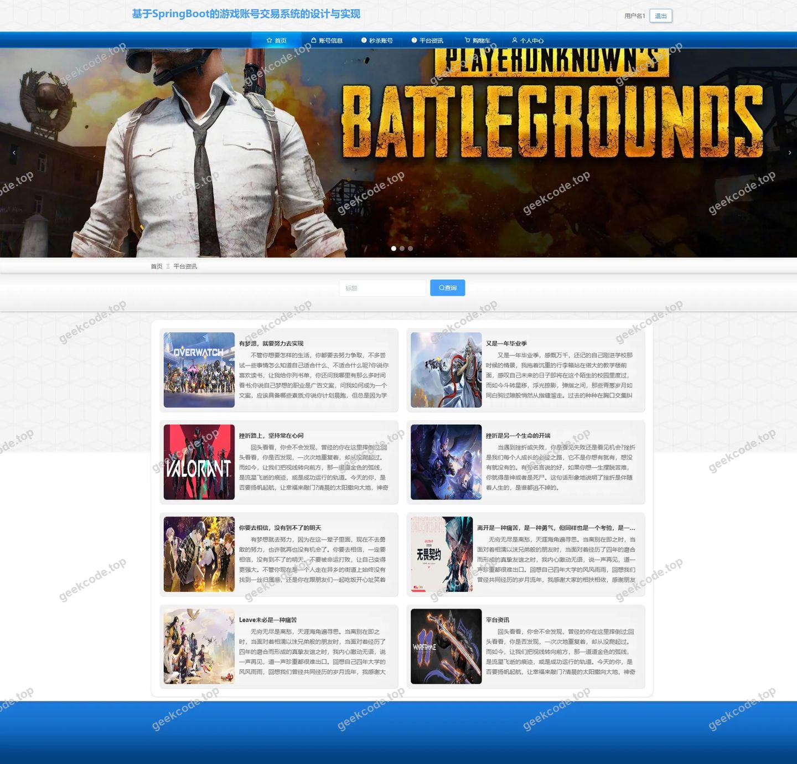</a>

<h3>后台管理端</h3>
<h4>后台-登录页</h4>

<a href="https://geekcode.top/archives/%E5%9F%BA%E4%BA%8ESpringBoot%E7%9A%84%E6%B8%B8%E6%88%8F%E8%B4%A6%E5%8F%B7%E4%BA%A4%E6%98%93%E7%B3%BB%E7%BB%9F%E7%9A%84%E8%AE%BE%E8%AE%A1%E4%B8%8E%E5%AE%9E%E7%8E%B0?utm_source=github" title="查看完整源码">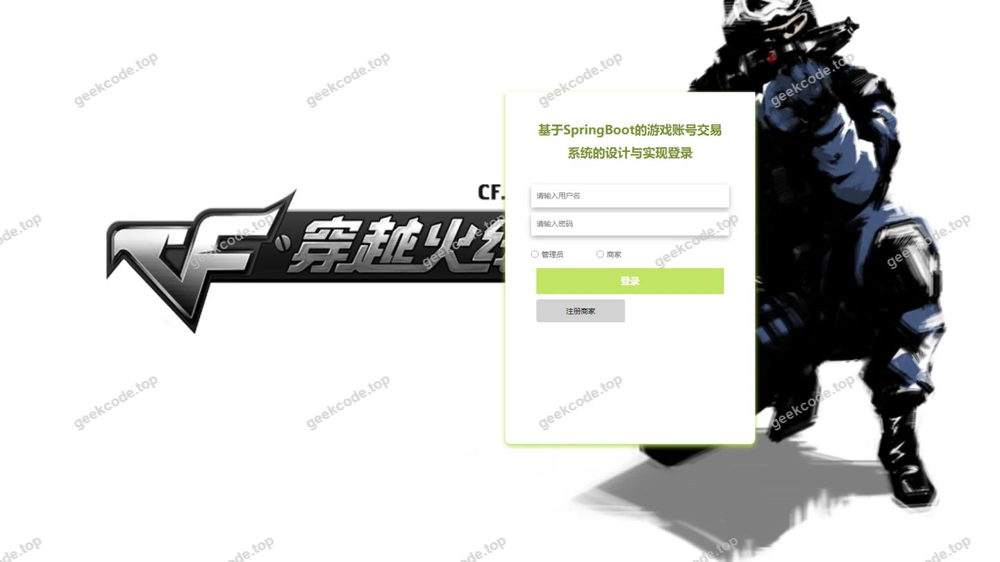</a>

<h4>后台-订单管理</h4>

<a href="https://geekcode.top/archives/%E5%9F%BA%E4%BA%8ESpringBoot%E7%9A%84%E6%B8%B8%E6%88%8F%E8%B4%A6%E5%8F%B7%E4%BA%A4%E6%98%93%E7%B3%BB%E7%BB%9F%E7%9A%84%E8%AE%BE%E8%AE%A1%E4%B8%8E%E5%AE%9E%E7%8E%B0?utm_source=github" title="查看完整源码">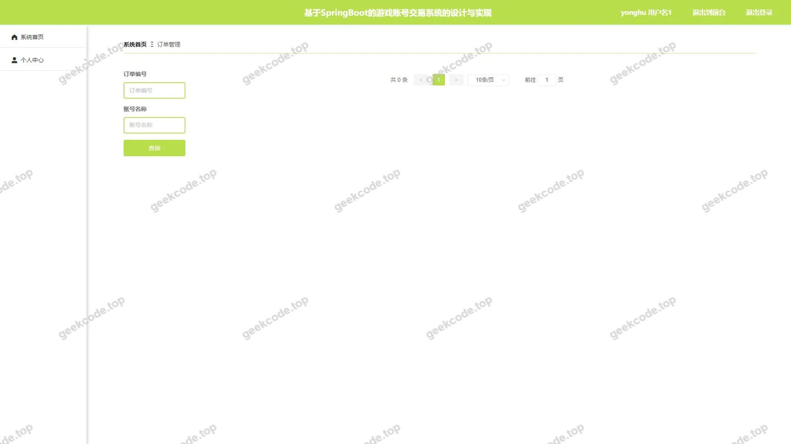</a>

<h4>后台-关于我们</h4>

<a href="https://geekcode.top/archives/%E5%9F%BA%E4%BA%8ESpringBoot%E7%9A%84%E6%B8%B8%E6%88%8F%E8%B4%A6%E5%8F%B7%E4%BA%A4%E6%98%93%E7%B3%BB%E7%BB%9F%E7%9A%84%E8%AE%BE%E8%AE%A1%E4%B8%8E%E5%AE%9E%E7%8E%B0?utm_source=github" title="查看完整源码">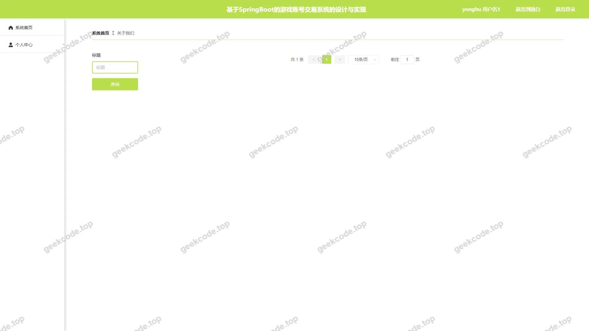</a>

<h4>后台-秒杀账号</h4>

<a href="https://geekcode.top/archives/%E5%9F%BA%E4%BA%8ESpringBoot%E7%9A%84%E6%B8%B8%E6%88%8F%E8%B4%A6%E5%8F%B7%E4%BA%A4%E6%98%93%E7%B3%BB%E7%BB%9F%E7%9A%84%E8%AE%BE%E8%AE%A1%E4%B8%8E%E5%AE%9E%E7%8E%B0?utm_source=github" title="查看完整源码">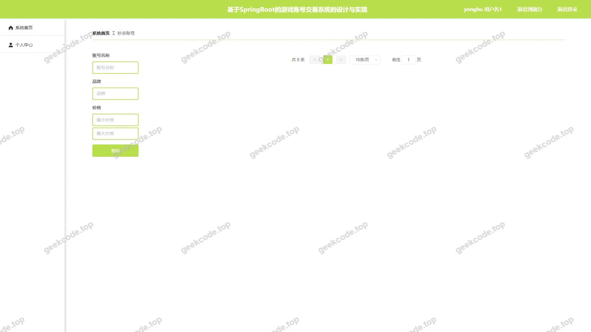</a>

<h4>后台-秒杀账号评论</h4>

<a href="https://geekcode.top/archives/%E5%9F%BA%E4%BA%8ESpringBoot%E7%9A%84%E6%B8%B8%E6%88%8F%E8%B4%A6%E5%8F%B7%E4%BA%A4%E6%98%93%E7%B3%BB%E7%BB%9F%E7%9A%84%E8%AE%BE%E8%AE%A1%E4%B8%8E%E5%AE%9E%E7%8E%B0?utm_source=github" title="查看完整源码">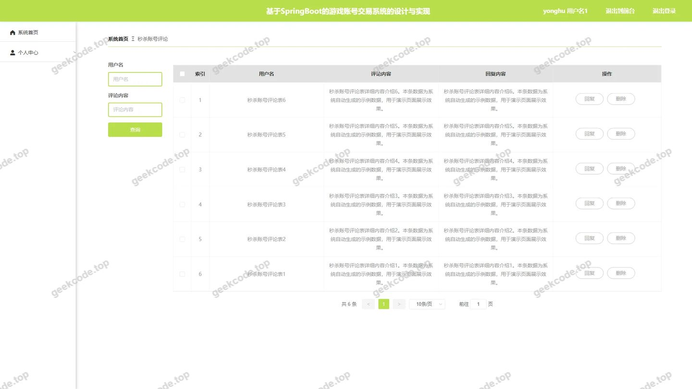</a>

<h4>后台-平台资讯</h4>

<a href="https://geekcode.top/archives/%E5%9F%BA%E4%BA%8ESpringBoot%E7%9A%84%E6%B8%B8%E6%88%8F%E8%B4%A6%E5%8F%B7%E4%BA%A4%E6%98%93%E7%B3%BB%E7%BB%9F%E7%9A%84%E8%AE%BE%E8%AE%A1%E4%B8%8E%E5%AE%9E%E7%8E%B0?utm_source=github" title="查看完整源码">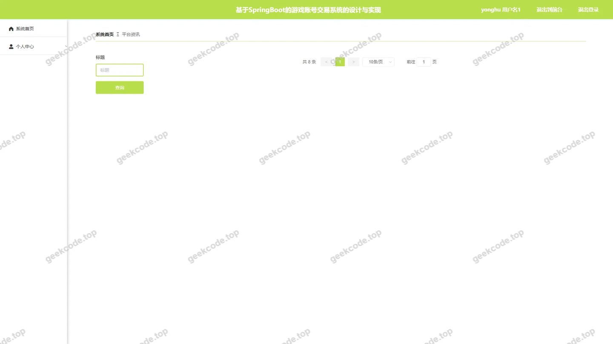</a>

<h4>后台首页</h4>

<a href="https://geekcode.top/archives/%E5%9F%BA%E4%BA%8ESpringBoot%E7%9A%84%E6%B8%B8%E6%88%8F%E8%B4%A6%E5%8F%B7%E4%BA%A4%E6%98%93%E7%B3%BB%E7%BB%9F%E7%9A%84%E8%AE%BE%E8%AE%A1%E4%B8%8E%E5%AE%9E%E7%8E%B0?utm_source=github" title="查看完整源码">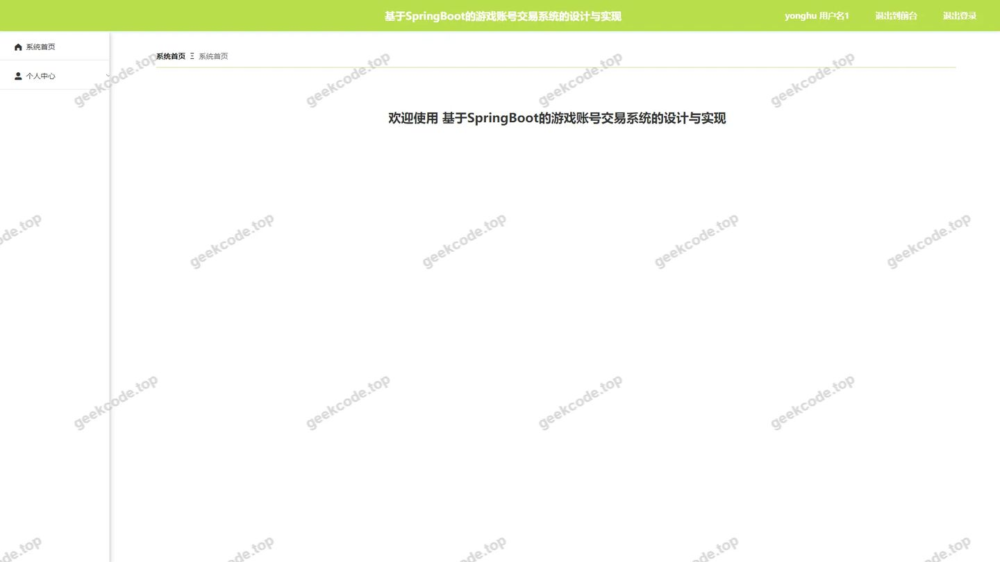</a>

<h4>后台-用户</h4>

<a href="https://geekcode.top/archives/%E5%9F%BA%E4%BA%8ESpringBoot%E7%9A%84%E6%B8%B8%E6%88%8F%E8%B4%A6%E5%8F%B7%E4%BA%A4%E6%98%93%E7%B3%BB%E7%BB%9F%E7%9A%84%E8%AE%BE%E8%AE%A1%E4%B8%8E%E5%AE%9E%E7%8E%B0?utm_source=github" title="查看完整源码">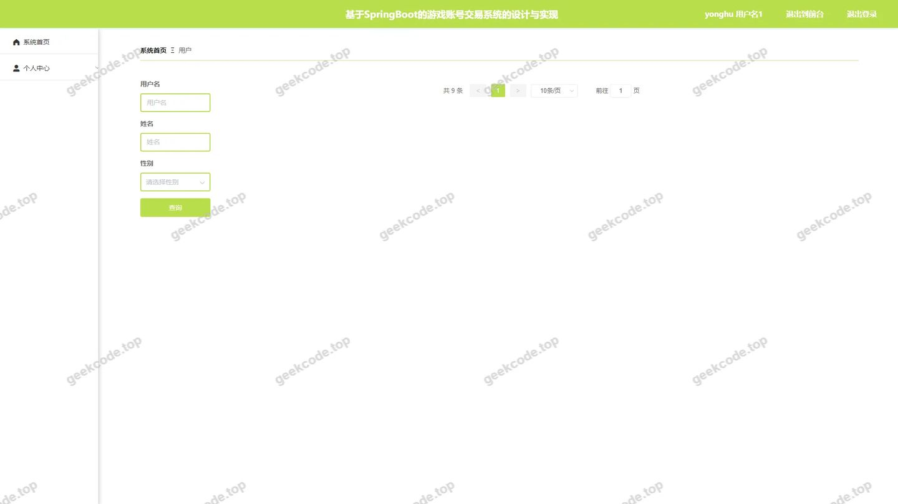</a>

<h4>后台-账号分类</h4>

<a href="https://geekcode.top/archives/%E5%9F%BA%E4%BA%8ESpringBoot%E7%9A%84%E6%B8%B8%E6%88%8F%E8%B4%A6%E5%8F%B7%E4%BA%A4%E6%98%93%E7%B3%BB%E7%BB%9F%E7%9A%84%E8%AE%BE%E8%AE%A1%E4%B8%8E%E5%AE%9E%E7%8E%B0?utm_source=github" title="查看完整源码">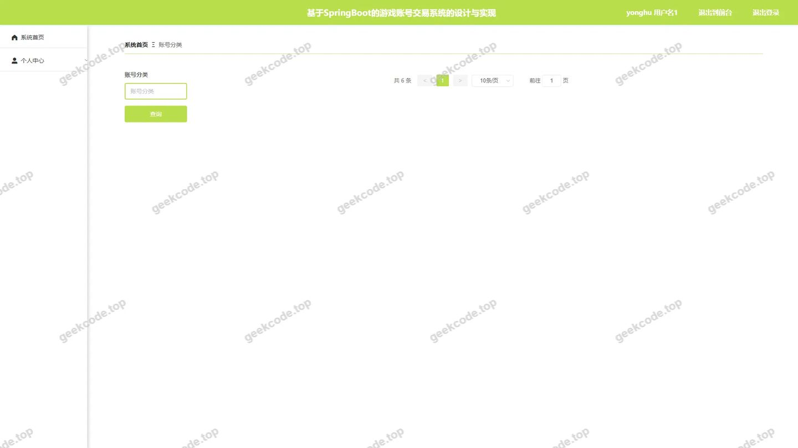</a>

---

## 获取完整源码

| 项目 | 说明 |
| --- | --- |
| 项目名 | 基于SpringBoot的游戏账号交易系统的设计与实现 |
| 运行截图 | 本文 17 张（站点带水印原图，仓库 `images/` 目录） |
| 完整源码 | [https://geekcode.top/archives/%E5%9F%BA%E4%BA%8ESpringBoot%E7%9A%84%E6%B8%B8%E6%88%8F%E8%B4%A6%E5%8F%B7%E4%BA%A4%E6%98%93%E7%B3%BB%E7%BB%9F%E7%9A%84%E8%AE%BE%E8%AE%A1%E4%B8%8E%E5%AE%9E%E7%8E%B0?utm_source=github](https://geekcode.top/archives/%E5%9F%BA%E4%BA%8ESpringBoot%E7%9A%84%E6%B8%B8%E6%88%8F%E8%B4%A6%E5%8F%B7%E4%BA%A4%E6%98%93%E7%B3%BB%E7%BB%9F%E7%9A%84%E8%AE%BE%E8%AE%A1%E4%B8%8E%E5%AE%9E%E7%8E%B0?utm_source=github) |
| 咨询微信 | **ir9372**（备注：jingpin-yuanma） |
| 更多项目 | [极客代码 geekcode.top](https://geekcode.top/?utm_source=github) |

> 需要源码、部署、改配置、跑不起来等问题，加微信 ir9372 沟通，说明项目名即可。
